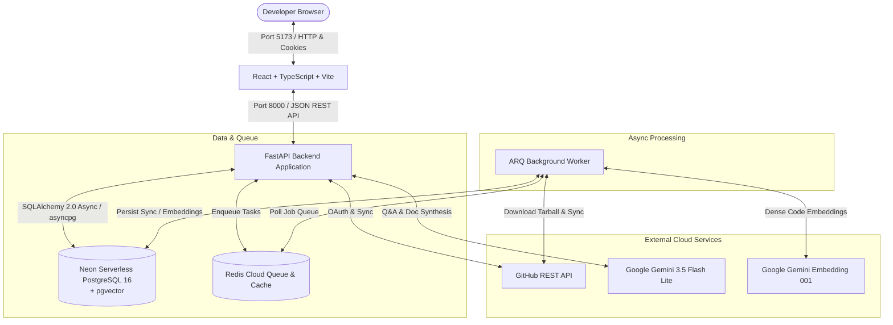

# Repo Cartographer

Repo Cartographer is an AI-powered codebase exploration and intelligence platform that connects GitHub repositories, synchronizes git metadata and full-text code trees, builds dense semantic vector representations with Google Gemini and pgvector, and delivers grounded developer workflows—including hybrid code search with Reciprocal Rank Fusion, conversational Q&A with strict source citation verification, architectural blueprint synthesis, and automated unit test generation.

---

## ✨ Features

### Core Capabilities
- **GitHub OAuth 2.0 & Session Security**: Secure web authentication flow with signed CSRF state cookies, AES-128 Fernet encryption for access tokens stored at rest, and stateless `httpOnly` session cookies.
- **Asynchronous Repository Sync**: Multi-stage background ingestion pipeline (Metadata -> Commits -> Pull Requests -> Issues) executed via ARQ and Redis with automated rate-limit pacing and conflict guards.
- **AST-Aware Code Chunking & Embeddings**: In-memory tarball processing extracting source files, chunking across logical function and class boundaries, and generating 768-dimensional embeddings using Google Gemini (`gemini-embedding-001`).
- **Hybrid Code Search (BM25 + pgvector)**: Combines PostgreSQL full-text search (`tsvector` keyword matching) with dense vector cosine similarity via Reciprocal Rank Fusion (RRF), complete with GitHub permalinks to exact lines.
- **Grounded Codebase Q&A (Ask)**: Context-aware codebase chat powered by Gemini (`gemini-3.5-flash-lite`) featuring strict anti-hallucination source citation validation (`[S1]`, `[S2]`) verified against active chunks.
- **Automated Architecture Documentation**: Analyzes project manifests, entry points, routing layers, and schema definitions to synthesize comprehensive markdown architecture overviews with clickable source markers.

### Developer Extras
- **Unit Test Generation**: Generates targeted unit test suites (e.g., Pytest or Vitest) tailored to individual source files, complete with AST syntax validity checks.
- **PR Risk Analysis**: *(Coming soon for repositories with pull request history)* Automated risk classification based on diff size, sensitive path modifications, and heuristic analysis.
- **Issue Classification & Duplicate Detection**: *(Coming soon for repositories with issue tracking enabled)* Multi-label issue tagging and vector-based semantic duplicate detection.

---

## 🗺️ System Architecture



---

## 🛠️ Technology Stack

| Layer | Technologies |
| :--- | :--- |
| **Frontend** | React 18, TypeScript, Vite, Tailwind CSS, Lucide Icons |
| **Backend API** | FastAPI, Python 3.11+, SQLAlchemy 2.0 (Async), Pydantic v2, Uvicorn |
| **Background Worker** | ARQ (Async Redis Queue), asyncio |
| **Database & Search** | Neon Serverless PostgreSQL 16, `pgvector`, PostgreSQL Full-Text Search (`tsvector`) |
| **Queue & Cache** | Redis Cloud |
| **AI & Embeddings** | Google Gemini (`gemini-embedding-001` for 768d vectors, `gemini-3.5-flash-lite` for LLM generation) |
| **External Auth** | GitHub OAuth 2.0 Web Application Flow |

---

## ⚡ Quick Start (Without Docker)

The recommended local development workflow runs on Windows PowerShell using virtual environments and background service scripts:

### Prerequisites
- Python 3.11+
- Node.js 18+ and `npm`
- Git

### 1. Launch All Services with One Command
Run the unified startup script in PowerShell:

```powershell
.\scripts\dev-all.ps1
```

This script:
1. Validates virtual environment and dependencies.
2. Runs environment diagnostics (`scripts\doctor.py`).
3. Starts the ARQ Background Worker in a separate terminal.
4. Starts the FastAPI Backend server on port `8000`.
5. Starts the Vite Frontend dev server on port `5173`.

Access the application in your browser at: **[http://localhost:5173](http://localhost:5173)**

*(Optional Docker Note: A `docker-compose.yml` is provided for containerized database and redis orchestration if local daemons are preferred, though Neon and Redis Cloud are the primary production targets).*

---

## ☁️ Cloud Services Setup

### 1. Neon PostgreSQL with pgvector
1. Create a free project at [neon.tech](https://neon.tech).
2. Under the SQL Editor, verify that the `pgvector` extension is enabled:
   ```sql
   CREATE EXTENSION IF NOT EXISTS vector;
   ```
3. Copy the pooled connection string into `DATABASE_URL` in `.env`.

### 2. Redis Cloud
1. Create a free Redis database at [redis.io](https://redis.io).
2. Copy the public connection endpoint and password into `REDIS_URL` (format: `redis://default:<password>@<host>:<port>`).

### 3. GitHub OAuth App
1. Navigate to **GitHub Settings -> Developer Settings -> OAuth Apps -> New OAuth App**.
2. Set **Application name** to `Repo Cartographer`.
3. Set **Homepage URL** to `http://localhost:5173`.
4. Set **Authorization callback URL** to `http://localhost:8000/auth/github/callback`.
5. Copy the generated **Client ID** and **Client Secret** into `GITHUB_CLIENT_ID` and `GITHUB_CLIENT_SECRET` in `.env`.

### 4. Google Gemini API Key
1. Obtain an API key from [Google AI Studio](https://aistudio.google.com).
2. Set `GEMINI_API_KEY` in `.env`.

---

## ⚙️ Environment Variables

Configure your `.env` file using `.env.example` as a template:

| Variable | Description |
| :--- | :--- |
| `ENVIRONMENT` | Runtime mode: `development`, `production`, or `test` |
| `DEBUG` | Enables verbose debug logging and interactive OpenAPI docs at `/docs` |
| `BACKEND_HOST` | Network interface to bind the API server (default: `0.0.0.0`) |
| `BACKEND_PORT` | Port for the FastAPI server (default: `8000`) |
| `FRONTEND_URL` | Public frontend URL used for OAuth callback redirection |
| `CORS_ORIGINS` | JSON list of allowed origins for cross-origin requests with credentials |
| `SECRET_KEY` | Cryptographic secret for signing session JWT tokens and CSRF state cookies |
| `FERNET_KEY` | 32-byte base64 key used for symmetric encryption of GitHub tokens at rest |
| `DATABASE_URL` | Asyncpg connection URL for Neon PostgreSQL |
| `TEST_DATABASE_URL` | Dedicated test database URL (prevents destructive test execution on primary DB) |
| `REDIS_URL` | Redis connection URL for caching and ARQ worker task queues |
| `ARQ_POLL_DELAY` | Frequency in seconds that worker polls Redis to conserve command quotas |
| `JOB_EXPIRY_TIMEOUT_SECONDS` | Inactivity threshold before unpicked jobs are expired |
| `GITHUB_CLIENT_ID` | Client ID from your registered GitHub OAuth Application |
| `GITHUB_CLIENT_SECRET` | Client Secret from your registered GitHub OAuth Application |
| `GITHUB_REDIRECT_URI` | OAuth callback redirect URL matching your GitHub App registration |
| `GEMINI_API_KEY` | Google Gemini API key used for code embeddings and generation |
| `EMBEDDING_MODEL` | Gemini embedding model identifier (default: `gemini-embedding-001`) |
| `EMBEDDING_DIM` | Dimensionality of code vectors (default: `768`) |
| `EMBED_BATCH_SIZE` | Chunk batch size sent to Gemini embeddings API (default: `16`) |
| `EMBED_MAX_WAIT_SECONDS` | Maximum cumulative backoff wait for Gemini rate limits (default: `600`) |
| `EMBED_REQUESTS_PER_MINUTE` | Pacing threshold for outgoing embedding API requests (default: `30`) |
| `INDEX_MAX_CHUNKS` | Maximum chunks indexed per repository (default: `1500`) |
| `LLM_MODEL` | Gemini generative model for Q&A and Documentation (default: `gemini-3.5-flash-lite`) |
| `DEMO_MODE` | Set to `false` for real service execution |

---

## 📸 Screenshots

Captured previews from the application (refer to [docs/screenshots/README.txt](docs/screenshots/README.txt) for capture details):

- **Repository Dashboard**: `docs/screenshots/dashboard.png`
- **Hybrid Code Search with Permalinks**: `docs/screenshots/repo_search.png`
- **Grounded Q&A (Ask) with Verified Citations**: `docs/screenshots/ask_answer.png`
- **Architecture Documentation Overview**: `docs/screenshots/architecture_doc.png`
- **Pull Request Risk Assessment**: `docs/screenshots/pr_risk_badge.png`
- **Automated Unit Test Generation**: `docs/screenshots/tests_tab.png`

---

## 🔍 How It Works

1. **Sync**: Asynchronously ingests repository metadata, commit histories, PR threads, and issues via ARQ with automatic pagination and rate-limit tracking.
2. **Chunking**: Breaks repository source files into semantic blocks using AST structure and line-budget windows.
3. **Embeddings**: Computes 768-dimensional dense vectors for code chunks using Google Gemini with dynamic request pacing and immediate per-batch database persistence.
4. **Hybrid Search with RRF**: Merges PostgreSQL keyword full-text search (`tsvector`) with pgvector cosine similarity distances using Reciprocal Rank Fusion to maximize recall and precision.
5. **Grounded Q&A with Citation Validation**: Injects retrieved code chunks into Gemini prompts alongside strict citation rules; post-generation validation checks that every citation marker matches an actual source block before returning the answer.
6. **Deterministic Risk Rules plus LLM**: Evaluates pull request blast radius, sensitive file modifications, and diff churn using rule-based metrics combined with AI summary synthesis.
7. **Duplicate Detection**: Computes semantic vector similarity between issue titles and descriptions to identify duplicate tickets in real time.

---

## ⚠️ Known Limitations

- **GitHub Public Rate Limits**: Unauthenticated GitHub requests fall back to 60 requests/hour when user OAuth tokens are expired or revoked.
- **Gemini Free Tier Quotas**: Heavy concurrent indexing of very large codebases may trigger rate limits; the indexer automatically throttles and resumes from the last saved chunk on retry.
- **Repository Size Caps**: Repositories exceeding `INDEX_MAX_REPO_DOWNLOAD_MB` (100MB) or `INDEX_MAX_FILES` (1,500) will index top-level and prioritized source files first.

---

## 🔧 Troubleshooting

- **Worker Not Running**:
  If job status stays on "queued" or "pending", ensure the ARQ worker is active:
  ```powershell
  .\scripts\dev-worker.ps1
  ```
- **Neon Serverless Cold Start**:
  Neon compute instances auto-suspend when idle. The first request may experience a 3-10 second delay while the instance resumes; the built-in database connection verifier retries automatically.
- **Gemini Rate Limit (HTTP 429)**:
  The built-in `GeminiRequestPacer` parses the `Retry-After` header and error body delay info with randomized jitter. If the 600-second wait budget expires, the indexer marks the job as partial; simply click **Index** again to resume without losing previously embedded chunks.
- **Port 5173 in Use**:
  If port 5173 is occupied, Vite will automatically switch to 5174. Update `FRONTEND_URL` and `CORS_ORIGINS` in your `.env` to match.
