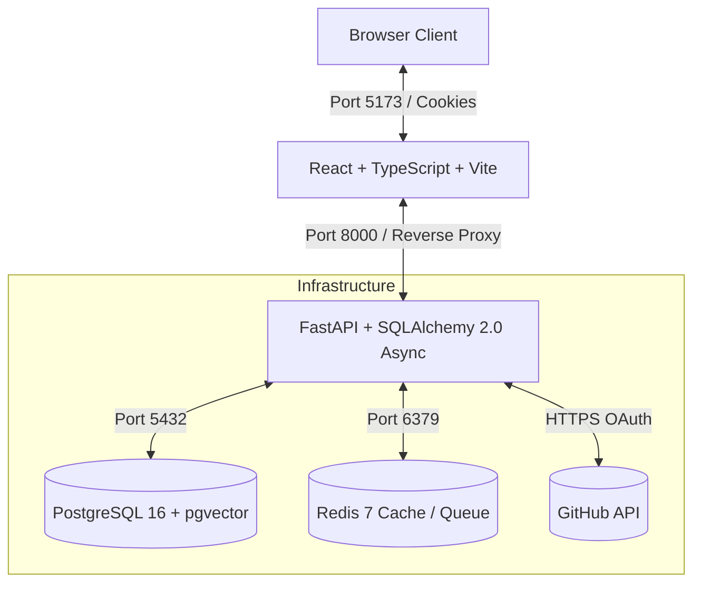

# repo-cartographer

> **AI Developer Productivity Platform**: Connect GitHub repositories, analyze commits, PRs, and issues, and answer questions about the codebase using RAG with citations.

---

## 🗺️ Architecture Overview



---

## 🚀 Phase Checklist

- [x] **Phase 1: Foundation + GitHub OAuth** (Complete)
  - Monorepo structure with FastAPI, React Vite TS, and Docker Compose
  - PostgreSQL 16 with `pgvector` extension and initial Alembic migration
  - Secure GitHub OAuth 2.0 web application flow with Fernet token encryption at rest
  - Signed CSRF state verification and `httpOnly`, `SameSite=Lax` session management
  - Health check endpoint (`/health`) validating DB and Redis connectivity
  - Pytest async suite with Respx mocks and Ruff linting in GitHub Actions CI
- [x] **Phase 2: Repository Import + Async GitHub Sync** (Complete)
  - Async GitHub API client with RFC 5988 pagination, rate limit tracking, and exponential backoff retry
  - Data models (`repositories`, `commits`, `pull_requests`, `issues`, `sync_jobs`) with Alembic migration `0002_ingestion_tables`
  - ARQ background worker integration (`app.worker:WorkerSettings`) with Redis job queue
  - 4-stage ingestion pipeline: Metadata -> Commits -> Pull Requests -> Issues (excluding PRs)
  - Idempotent PostgreSQL upserts (`INSERT ... ON CONFLICT DO UPDATE`)
  - Full REST API suite for repository discovery, import, status polling, and commit/PR/issue listing with filters
  - Modern React frontend with modal repo importer, real-time polling sync status cards, and tabbed repo inspection
- [ ] **Phase 3: AST Parsing & Codebase Graph Construction**
  - AST analysis and symbol relationship extraction (classes, functions, imports)
  - Codebase dependency and knowledge graph generation
- [ ] **Phase 4: Embeddings & pgvector Storage**
  - Chunking strategies for source code and metadata
  - Vector embedding generation and pgvector similarity index setup
- [ ] **Phase 5: Hybrid RAG Engine with Citations**
  - Graph + vector hybrid retrieval pipeline
  - LLM synthesis answering architectural questions with exact file and line citations
- [ ] **Phase 6: Interactive Cartographer UI**
  - Codebase graph visualization
  - Interactive copilot chat interface with deep-linked citations

---

## ⚙️ Environment Variables

Copy `.env.example` to `.env` and configure the following variables:

| Variable | Type | Default | Description |
| :--- | :--- | :--- | :--- |
| `ENVIRONMENT` | string | `development` | Runtime environment (`development`, `production`, `test`) |
| `DEBUG` | boolean | `true` | Enable debug logs and interactive FastAPI `/docs` |
| `BACKEND_HOST` | string | `0.0.0.0` | Bind host for FastAPI server |
| `BACKEND_PORT` | integer | `8000` | Port for FastAPI backend |
| `FRONTEND_URL` | string | `http://localhost:5173` | Public frontend URL for OAuth redirects |
| `CORS_ORIGINS` | JSON list | `["http://localhost:5173"]` | Allowed origins for CORS with credentials |
| `SECRET_KEY` | string | *required* | Secret key for signing session JWTs and OAuth states |
| `FERNET_KEY` | string | *required* | 32-byte base64 Fernet key to encrypt GitHub tokens at rest |
| `ALGORITHM` | string | `HS256` | JWT signing algorithm |
| `ACCESS_TOKEN_EXPIRE_MINUTES` | integer | `10080` (7 days) | Session duration in minutes |
| `SESSION_COOKIE_NAME` | string | `rc_session` | Name of the session JWT cookie |
| `OAUTH_STATE_COOKIE_NAME` | string | `rc_oauth_state` | Name of the short-lived signed state cookie |
| `POSTGRES_USER` | string | `postgres` | PostgreSQL username |
| `POSTGRES_PASSWORD` | string | `postgres` | PostgreSQL password |
| `POSTGRES_DB` | string | `repo_cartographer` | Database name |
| `POSTGRES_HOST` | string | `postgres` | Database host (or `localhost` for local dev) |
| `POSTGRES_PORT` | integer | `5432` | Database port |
| `DATABASE_URL` | string | *derived* | Full asyncpg connection string |
| `REDIS_HOST` | string | `redis` | Redis host |
| `REDIS_PORT` | integer | `6379` | Redis port |
| `REDIS_URL` | string | `redis://redis:6379/0` | Redis connection URL |
| `GITHUB_CLIENT_ID` | string | *required* | GitHub OAuth App Client ID |
| `GITHUB_CLIENT_SECRET` | string | *required* | GitHub OAuth App Client Secret |
| `GITHUB_REDIRECT_URI` | string | `http://localhost:8000/auth/github/callback` | OAuth redirect URI configured in GitHub |
| `SYNC_MAX_COMMITS` | integer | `500` | Max commits to fetch during repository sync |
| `SYNC_MAX_PRS` | integer | `200` | Max pull requests to fetch during sync |
| `SYNC_MAX_ISSUES` | integer | `200` | Max issues to fetch during sync |
| `SYNC_STATS_COMMITS_LIMIT` | integer | `25` | Number of recent commits to fetch per-item line stats |
| `SYNC_STATS_PRS_LIMIT` | integer | `25` | Number of recent PRs to fetch per-item line stats |

---

## 📡 API Endpoints (Phase 2)

| Method | Endpoint | Description |
| :--- | :--- | :--- |
| `GET` | `/health` | Service health status (DB + Redis) |
| `GET` | `/auth/github/login` | Initiate GitHub OAuth flow |
| `GET` | `/auth/github/callback` | OAuth callback and token exchange |
| `GET` | `/auth/me` | Current authenticated user profile |
| `POST` | `/auth/logout` | Clear session cookie |
| `GET` | `/repos/available` | List user repositories on GitHub available for import |
| `POST` | `/repos/import` | Import a repository and enqueue background sync job |
| `GET` | `/repos` | List all repositories imported by the current user |
| `GET` | `/repos/{id}` | Get repository details (enforces ownership) |
| `DELETE`| `/repos/{id}` | Delete repository and all cascading records |
| `POST` | `/repos/{id}/sync` | Trigger asynchronous re-sync |
| `GET` | `/repos/{id}/sync-status`| Get active or latest sync job progress and stage |
| `GET` | `/repos/{id}/commits` | List ingested commits (filter by author, date range) |
| `GET` | `/repos/{id}/pulls` | List ingested PRs (filter by state: `open`\|`closed`\|`all`, author) |
| `GET` | `/repos/{id}/issues` | List ingested issues excluding PRs (filter by state, author) |

---

## 💻 Quickstart (Run Without Docker - Default)

### 1. Prerequisites
- **Python 3.11+** and **Node.js 18+**
- **Hosted PostgreSQL with pgvector** (e.g. [Neon](https://neon.tech))
- **Hosted Redis** (e.g. [Upstash](https://upstash.com) or Redis Cloud)
- **GitHub OAuth App** configured at [GitHub Developer Settings](https://github.com/settings/developers) with:
  - **Homepage URL**: `http://localhost:5173`
  - **Authorization callback URL**: `http://localhost:8000/auth/github/callback`

### 2. Configure Environment
```powershell
Copy-Item .env.example .env
```
Fill in `.env` with:
- `DATABASE_URL`: Your Neon Postgres connection string (accepts Neon URL as copied, including `?sslmode=require&channel_binding=require`)
- `TEST_DATABASE_URL`: Separate Neon branch for isolated integration tests
- `REDIS_URL`: Your Redis connection string (`redis://` or `rediss://`)
- `GITHUB_CLIENT_ID` & `GITHUB_CLIENT_SECRET`: From your GitHub OAuth app
- `GEMINI_API_KEY`: Google Gemini API key for embeddings

Verify your environment and connectivity with the doctor script:
```powershell
& backend/.venv/Scripts/python.exe scripts/doctor.py
```

### 3. Apply Migrations
```powershell
.\scripts\dev-migrate.ps1
```

### 4. Run Services
Run each of the following in separate PowerShell terminal windows:
- **FastAPI Backend**:
  ```powershell
  .\scripts\dev-api.ps1
  ```
- **ARQ Background Worker**:
  ```powershell
  .\scripts\dev-worker.ps1
  ```
- **React Frontend**:
  ```powershell
  .\scripts\dev-frontend.ps1
  ```

---

## 🛠️ Alternative: Docker Compose

If running on Linux or Docker Desktop with WSL2:
```bash
docker compose up --build
```
The services will initialize on ports 5173 (Frontend), 8000 (API), 5432 (Postgres + pgvector), and 6379 (Redis).

---

## 🧪 Testing & Linting

### Running Backend Tests
```bash
cd backend
pytest -v
```

### Running Linter
```bash
cd backend
ruff check .
```

### Running Frontend Build Verification
```bash
cd frontend
npm run build
```
