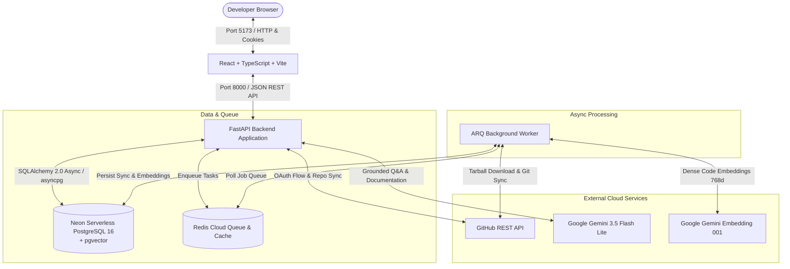

# 🗺️ Repo Cartographer

<div align="center">

[](https://fastapi.tiangolo.com)
[](https://react.dev)
[](https://www.typescriptlang.org)
[](https://vitejs.dev)
[](https://neon.tech)
[](https://redis.io)
[](https://aistudio.google.com)
[](LICENSE)

<br/>

**Map any GitHub repo. Ask it anything. Grounded code search, semantic cartography, and developer intelligence.**

<br/>


</div>

---

## 📖 Table of Contents

- [Overview](#-overview)
- [✨ Product Tour & Screenshots](#-product-tour--screenshots)
  - [1. Liquid Glass Authentication Portal](#1-liquid-glass-authentication-portal)
  - [2. Tracked Repositories & Real-Time System Health](#2-tracked-repositories--real-time-system-health)
  - [3. Interactive GitHub Repository Import](#3-interactive-github-repository-import)
  - [4. Asynchronous Codebase Indexing Pipeline](#4-asynchronous-codebase-indexing-pipeline)
  - [5. Deep Git History & Ingested Commits](#5-deep-git-history--ingested-commits)
- [⚡ Key Capabilities](#-key-capabilities)
- [🗺️ System Architecture](#️-system-architecture)
- [🛠️ Technology Stack](#️-technology-stack)
- [🚀 Quick Start (Local Development)](#-quick-start-local-development)
- [☁️ Cloud Services Configuration](#️-cloud-services-configuration)
- [⚙️ Environment Variables](#️-environment-variables)
- [🛡️ Security & Reliability Engineering](#️-security--reliability-engineering)
- [🩺 Diagnostics & Health Checks](#-diagnostics--health-checks)
- [🔧 Troubleshooting](#-troubleshooting)

---

## 🌟 Overview

**Repo Cartographer** is an enterprise-grade codebase exploration and intelligence platform. It seamlessly connects with GitHub repositories, indexes source trees using AST-aware parsing, builds 768-dimensional dense vector embeddings with Google Gemini and PostgreSQL `pgvector`, and provides developers with:

1. **Hybrid Code Search**: Blending BM25 full-text keyword retrieval (`tsvector`) and dense vector similarity via Reciprocal Rank Fusion (RRF).
2. **Grounded Codebase Q&A (Ask)**: Contextual generative answers powered by Gemini 3.5 Flash Lite with strict, verified source citation anchors (`[S1]`, `[S2]`).
3. **Automated Architectural Blueprints**: One-click synthesis of file trees, module dependencies, API entry points, and database schemas.
4. **Intelligent Unit Test Generation**: Automated test suite generation with AST syntax validation.
5. **PR Risk Assessment & Duplicate Detection**: Semantic issue triage and pull request blast-radius analysis.

Designed with a state-of-the-art **Liquid Glass on Dark Aurora** user interface, Repo Cartographer offers high-performance developer ergonomics with fluid GPU-accelerated motion and responsive feedback.

---

## ✨ Product Tour & Screenshots

### 1. Liquid Glass Authentication Portal
Secure OAuth 2.0 gateway built with translucent frosted glass, dynamic ambient aurora glow, and zero-compromise credential security.


- **GitHub OAuth 2.0 Flow**: Direct web authorization requesting minimal necessary scopes (`read:user`, `user:email`, `repo`).
- **Cryptographic Token Safety**: Access tokens are symmetrically encrypted at rest using Fernet AES-128 before database storage.
- **Stateless Session Management**: Signed `httpOnly`, `SameSite=Lax` cookies prevent CSRF and token exfiltration.

---

### 2. Tracked Repositories & Real-Time System Health
Central hub displaying synchronized repositories alongside active cloud infrastructure diagnostics.


- **Live Service Telemetry**: Dynamic connectivity status monitoring for Neon Serverless PostgreSQL (`pgvector`), Redis Cloud job queue, and ARQ background worker.
- **Repository Cards**: Visual sync status indicators (`SYNC: READY`, `INDEXED`), primary language detection, branch tracking, and one-click re-synchronization.
- **Authenticated Identity Card**: Quick verification of connected GitHub account, GitHub ID, and active Fernet encryption badge.

---

### 3. Interactive GitHub Repository Import
Effortlessly explore and enroll personal or organizational repositories with real-time fuzzy search.


- **Instant Debounced Search**: Fast filtering across all authorized public and private GitHub repositories.
- **Visibility Badges**: Visual separation of public vs. private codebases.
- **Deduplication Protection**: Automatically detects already tracked repositories with disabled `✓ Imported` status chips to prevent duplicate cartography pipelines.

---

### 4. Asynchronous Codebase Indexing Pipeline
Multi-stage background processing pipeline keeping you informed with live granular progress bars and status banners.


- **8-Stage Pipeline**: Real-time progress updates across `[queued]`, `[downloading]`, `[extracting]`, `[filtering]`, `[chunking]`, `[embedding]`, `[persisting]`, and `[completed]`.
- **AST-Aware Chunking**: Intelligently segments code across function definitions, class declarations, and logical blocks without breaking syntax.
- **Resilient Batch Processing**: Persists embeddings per-batch into pgvector with exponential backoff and rate-limit jitter to handle Gemini quotas safely.

---

### 5. Deep Git History & Ingested Commits
Liquid glass data grid mapping complete repository commit histories with line change statistics and author attribution.


- **Commit Cartography**: Inspect SHA hashes, commit messages, author handles, timestamps, and line insertions/deletions.
- **Author Filtering**: Instant client-side search to isolate changes by specific contributors.
- **Active Stage Banner**: Non-intrusive progress reporting showing current indexing phase while navigating git histories.

---

## ⚡ Key Capabilities

### 🔍 Hybrid Code Search (BM25 + pgvector)
Combines PostgreSQL full-text search (`tsvector` keyword matching) with dense vector cosine similarity via **Reciprocal Rank Fusion (RRF)**:
```
RRF_Score(d) = Σ [ 1 / (k + rank_keyword(d)) ] + Σ [ 1 / (k + rank_semantic(d)) ]
```
- Direct permalinks to exact GitHub line numbers (`#L12-L48`).
- Zero hallucination: results are verified against raw files stored in the repository.

### 💬 Grounded Codebase Q&A (Ask)
- Context-aware dialogue powered by Google Gemini (`gemini-3.5-flash-lite`).
- Strict citation validation: Answers cite source code chunks as `[S1]`, `[S2]`. The backend verifies every citation against active retrieved chunks before streaming to the client.

### 📑 Automated Architecture Blueprints
- Synthesizes comprehensive markdown documentation covering:
  - System architecture & runtime topology.
  - Manifest and dependency breakdown (`package.json`, `requirements.txt`).
  - Primary API routes and controller layers.
  - Database schema & entity-relationship overviews.

### 🧪 Automated Unit Test Generation
- Generates targeted test suites (Pytest or Vitest) tailored to individual source files.
- Automatically validates syntax correctness using AST parsing before rendering to the developer.

### 🛡️ PR Risk Assessment & Duplicate Detection
- Computes deterministic pull request blast radius, sensitive file modification warnings, and diff churn.
- Multi-label issue tagging and vector-based semantic duplicate detection.

---

## 🗺️ System Architecture



---

## 🛠️ Technology Stack

| Layer | Component | Description |
| :--- | :--- | :--- |
| **Frontend** | React 18, TypeScript, Vite | High-performance SPA with fast HMR and optimized bundling |
| **Styling & UI** | Liquid Glass on Dark Aurora | Modern custom CSS design system with GPU blur and fluid motion |
| **Typography** | Inter & JetBrains Mono | Self-hosted via `@fontsource` for optimal load times and zero CDN dependency |
| **Backend API** | FastAPI, Python 3.11+ | Asynchronous REST API with Pydantic v2 validation and OpenAPI docs |
| **Database** | Neon Serverless PostgreSQL 16 | Serverless Postgres with `pgvector` for vector similarity queries |
| **ORM / Driver** | SQLAlchemy 2.0 (Async) + asyncpg | Type-safe asynchronous SQL query generation and pooling |
| **Queue & Worker** | Redis Cloud + ARQ | Distributed async job queue for repository ingestion and indexing |
| **AI / Embeddings** | Google Gemini `embedding-001` | Generates 768-dimensional dense vector embeddings |
| **AI / Generative** | Google Gemini `3.5-flash-lite` | High-speed LLM for codebase reasoning, Q&A, and documentation |
| **Authentication** | GitHub OAuth 2.0 | Symmetric AES-128 Fernet encrypted token storage at rest |

---

## 🚀 Quick Start (Local Development)

### Prerequisites
- **Python 3.11+** installed
- **Node.js 18+** and `npm` installed
- **Git** installed
- Active **Neon PostgreSQL**, **Redis Cloud**, and **Google Gemini** accounts (all have generous free tiers)

### 1. Clone & Configure Environment
```bash
git clone https://github.com/avanthikasreejith8923-a11y/repo-cartographer.git
cd repo-cartographer
cp .env.example .env
```
*(Fill in your `.env` values following the [Cloud Services Setup](#️-cloud-services-configuration) section below).*

### 2. Launch All Services with One Command (Windows PowerShell)
Run the automated unified launcher script:
```powershell
.\scripts\dev-all.ps1
```
This script will:
1. Verify prerequisites and virtual environment.
2. Run system diagnostics (`scripts/doctor.py`).
3. Start the FastAPI backend server on `http://localhost:8000`.
4. Start the ARQ background worker.
5. Start the Vite frontend dev server on `http://localhost:5173`.

Access the application in your browser at: **[http://localhost:5173](http://localhost:5173)**

---

### Individual Service Scripts (PowerShell)
If you prefer running services in dedicated terminals:

| Task | Script Command | Description |
| :--- | :--- | :--- |
| **All Services** | `.\scripts\dev-all.ps1` | Starts API, worker, frontend, and runs doctor checks |
| **Backend API** | `.\scripts\dev-api.ps1` | Starts FastAPI on `http://localhost:8000` |
| **Background Worker** | `.\scripts\dev-worker.ps1` | Starts ARQ worker process connected to Redis |
| **Frontend Dev** | `.\scripts\dev-frontend.ps1` | Starts Vite dev server on `http://localhost:5173` |
| **DB Migrations** | `.\scripts\dev-migrate.ps1` | Applies Alembic database schema migrations |
| **System Diagnostics**| `python scripts\doctor.py` | Runs 10 comprehensive connectivity & security checks |
| **End-to-End Test** | `python scripts\e2e_live_check.py` | Executes complete live system verification flow |

---

## ☁️ Cloud Services Configuration

### 1. Neon PostgreSQL with pgvector
1. Create a free database at [neon.tech](https://neon.tech).
2. Open the Neon SQL Editor and enable the vector extension:
   ```sql
   CREATE EXTENSION IF NOT EXISTS vector;
   ```
3. Copy the pooled connection string into `DATABASE_URL` in `.env` (ensure protocol is `postgresql+asyncpg://`).

### 2. Redis Cloud
1. Create a free database instance at [redis.io](https://redis.io).
2. Copy the public endpoint and password into `REDIS_URL` in `.env`:
   ```
   REDIS_URL=redis://default:<password>@<host>:<port>
   ```

### 3. GitHub OAuth Application
1. Navigate to **GitHub Settings -> Developer Settings -> OAuth Apps -> New OAuth App**.
2. Fill in the parameters:
   - **Application name**: `Repo Cartographer`
   - **Homepage URL**: `http://localhost:5173`
   - **Authorization callback URL**: `http://localhost:8000/auth/github/callback`
3. Copy **Client ID** and **Client Secret** into `GITHUB_CLIENT_ID` and `GITHUB_CLIENT_SECRET` in `.env`.

### 4. Google Gemini API
1. Create an API key at [Google AI Studio](https://aistudio.google.com).
2. Set `GEMINI_API_KEY` in `.env`.

---

## ⚙️ Environment Variables

| Variable | Default | Description |
| :--- | :--- | :--- |
| `ENVIRONMENT` | `development` | Runtime mode: `development`, `production`, or `test` |
| `DEBUG` | `true` | Enables verbose debug logging and Swagger docs at `/docs` |
| `BACKEND_HOST` | `0.0.0.0` | Network interface to bind the API server |
| `BACKEND_PORT` | `8000` | Port for the FastAPI server |
| `FRONTEND_URL` | `http://localhost:5173` | Public frontend URL used for OAuth redirections |
| `CORS_ORIGINS` | `["http://localhost:5173"]` | Allowed origins for cross-origin credentials |
| `SECRET_KEY` | *(Required)* | Secret key for signing session tokens and CSRF state cookies |
| `FERNET_KEY` | *(Required)* | 32-byte base64 key for encrypting GitHub tokens at rest |
| `DATABASE_URL` | *(Required)* | Asyncpg connection string for Neon PostgreSQL |
| `REDIS_URL` | *(Required)* | Redis Cloud connection URL for caching and ARQ queues |
| `ARQ_POLL_DELAY` | `0.5` | Polling frequency in seconds to conserve Redis command quotas |
| `JOB_EXPIRY_TIMEOUT_SECONDS`| `3600` | Timeout threshold before unpicked jobs are expired |
| `GITHUB_CLIENT_ID` | *(Required)* | Client ID from GitHub OAuth App registration |
| `GITHUB_CLIENT_SECRET` | *(Required)* | Client Secret from GitHub OAuth App registration |
| `GITHUB_REDIRECT_URI` | `http://localhost:8000/auth/github/callback` | OAuth redirect URI |
| `GEMINI_API_KEY` | *(Required)* | Google Gemini API key for embeddings and Q&A |
| `EMBEDDING_MODEL` | `gemini-embedding-001`| Model for generating 768-dimensional code vectors |
| `EMBEDDING_DIM` | `768` | Dimensionality of embeddings |
| `EMBED_BATCH_SIZE` | `16` | Batch size per embedding API request |
| `EMBED_MAX_WAIT_SECONDS` | `600` | Maximum wait ceiling during rate-limit backoff |
| `EMBED_REQUESTS_PER_MINUTE` | `30` | Pacing threshold for outgoing embedding requests |
| `INDEX_MAX_CHUNKS` | `1500` | Maximum code chunks indexed per repository |
| `LLM_MODEL` | `gemini-3.5-flash-lite` | Generative LLM for Q&A and architecture synthesis |
| `DEMO_MODE` | `false` | Must be `false` for live cloud services execution |

---

## 🛡️ Security & Reliability Engineering

- **At-Rest Token Encryption**: All GitHub OAuth user tokens are encrypted using **Fernet AES-128-CBC** with HMAC authentication before being written to PostgreSQL.
- **CSRF State Verification**: OAuth state tokens are cryptographically signed with short TTLs to mitigate CSRF attacks during external redirects.
- **Rate-Limit Backoff with Jitter**: Ingestion and embedding pipelines implement intelligent token bucket pacing and exponential backoff with randomized jitter to stay within external API quotas.
- **Per-Batch Vector Persistence**: Vector embeddings are committed to PostgreSQL incrementally per batch. If a process is interrupted, re-indexing automatically resumes without discarding previously computed vectors.
- **Strict Citation Validation**: Q&A outputs are parsed with citation checkers. Any marker `[S#]` that cannot be verified against the retrieved context is pruned, preventing hallucinated references.

---

## 🩺 Diagnostics & Health Checks

Verify your complete system connectivity anytime using the built-in doctor:

```powershell
python scripts\doctor.py
```

Expected diagnostic output:
```
=== Repo Cartographer System Doctor ===
[PASS] Python Version (3.11+)
[PASS] Environment Configuration (.env loaded)
[PASS] Secret Keys & Fernet Key Validity
[PASS] PostgreSQL Database Connection (Neon)
[PASS] pgvector Extension Active
[PASS] Database Schema & Tables In Sync
[PASS] Redis Cloud Connectivity
[PASS] ARQ Worker Queue Accessible
[PASS] Google Gemini API Connectivity (Embedding & LLM)
[PASS] GitHub OAuth Credentials Validated
--------------------------------------------------
Result: 10/10 checks passed. System ready for cartography!
```

---

## 🔧 Troubleshooting

### Worker Process Not Running
- If repository indexing or synchronization stays in `queued` status, verify the ARQ background worker is running:
  ```powershell
  .\scripts\dev-worker.ps1
  ```
- Check Redis Cloud connectivity using `python scripts\doctor.py`.

### Neon Serverless Database Cold Start
- Neon compute endpoints automatically suspend when inactive. The initial connection may take 3–8 seconds while the compute instance wakes up; connection retries are automatically handled by the backend connection verifier.

### Gemini Rate Limiting (HTTP 429)
- Repo Cartographer includes an adaptive `GeminiRequestPacer`. If you exceed free-tier quotas on large repositories, the system throttles automatically. If the backoff ceiling is reached, simply click **Re-index** to pick up seamlessly where it left off.

### Port 5173 Already in Use
- If port 5173 is occupied, Vite will automatically switch to port 5174. Be sure to update `FRONTEND_URL` and `CORS_ORIGINS` in `.env` to match the active port.

---

<div align="center">
  <sub>Built with ❤️ for developers by the Repo Cartographer Team.</sub>
</div>
