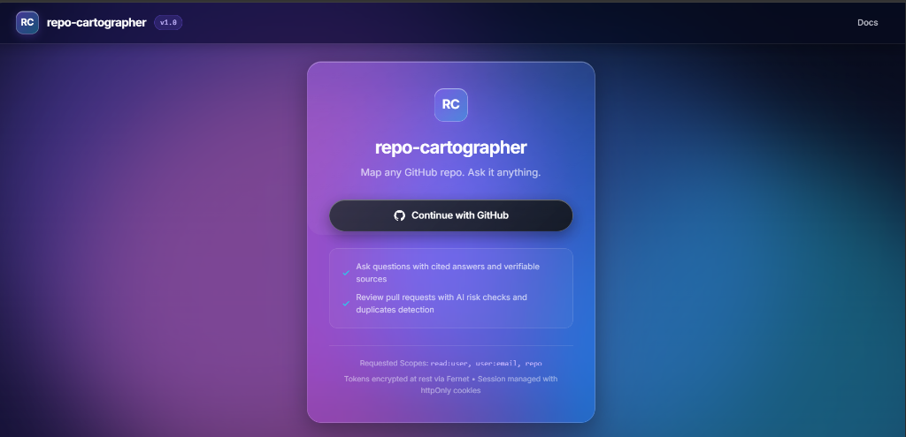
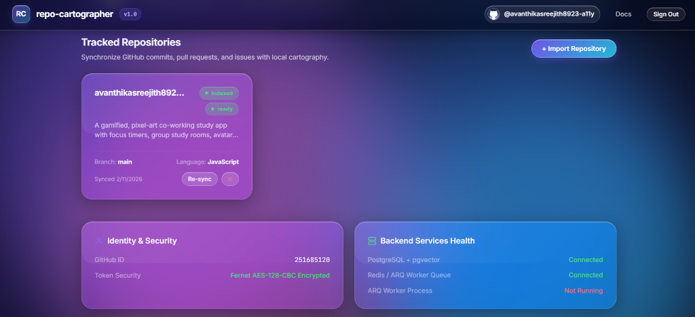
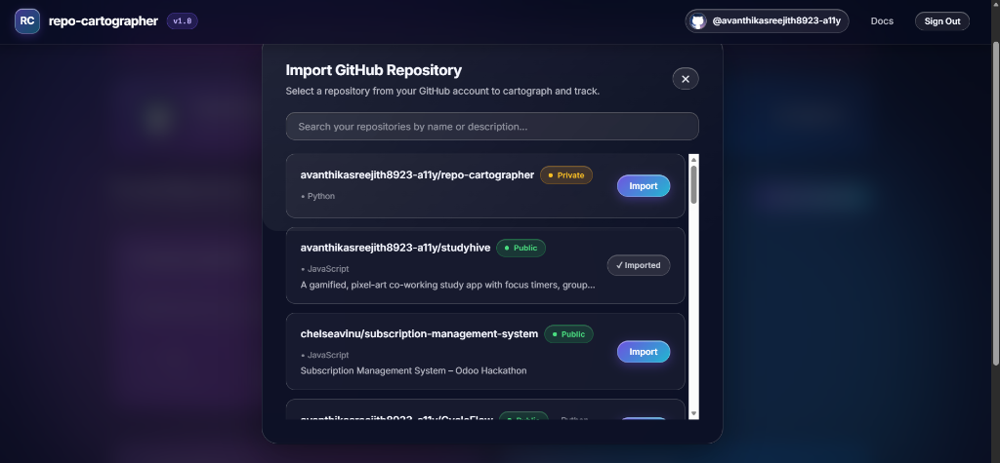
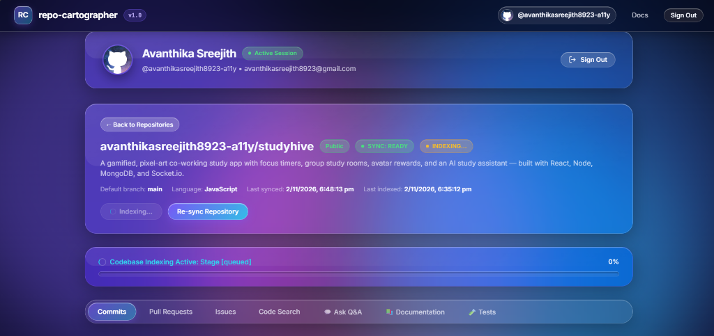
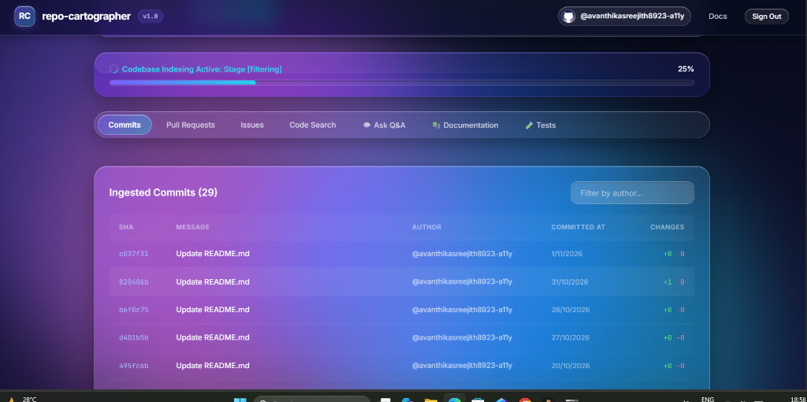
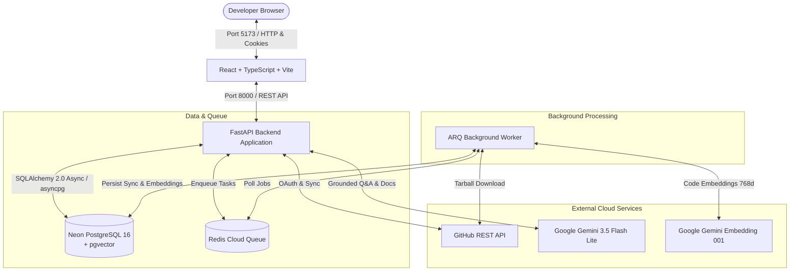

# 🗺️ Repo Cartographer

[](https://fastapi.tiangolo.com)
[](https://react.dev)
[](https://www.typescriptlang.org)
[](https://vitejs.dev)
[](https://neon.tech)
[](https://redis.io)
[](https://aistudio.google.com)
[](LICENSE)

An AI-powered codebase exploration and intelligence platform. Connect your GitHub repositories, index source code trees into dense semantic vectors, and perform hybrid code search, conversational Q&A with strict source citations, automated architectural blueprint synthesis, and unit test generation.

**Author:** [Avanthika Sreejith](https://github.com/avanthikasreejith8923-a11y)

---

## ⚡ Features

- **GitHub OAuth 2.0**: Secure authentication with AES-128 Fernet encrypted token storage at rest and `httpOnly` session cookies.
- **Asynchronous Repo Sync**: Ingests repository metadata, commit histories, pull requests, and issues in the background using ARQ and Redis.
- **AST-Aware Chunking & Dense Embeddings**: Extracts code structure across function and class boundaries, generating 768-dimensional embeddings via Google Gemini (`gemini-embedding-001`).
- **Hybrid Code Search**: Combines PostgreSQL full-text search (`tsvector`) and vector similarity via **Reciprocal Rank Fusion (RRF)** with GitHub permalinks to exact code lines.
- **Grounded Codebase Q&A (Ask)**: Ask natural language questions about your codebase powered by Google Gemini (`gemini-3.5-flash-lite`) with verified citations (`[S1]`, `[S2]`) to prevent hallucinations.
- **Automated Architecture Documentation**: Analyzes project entry points, dependencies, routing, and schemas to generate comprehensive architecture documentation.
- **Unit Test Generation**: Synthesizes test suites (Pytest/Vitest) with built-in AST syntax verification.
- **Modern Liquid Glass UI**: Clean dark aurora design with real-time indexing progress indicators and responsive interactions.

---

## 📸 Screenshots

### 1. Authentication Portal
*Secure GitHub OAuth login gateway with Fernet AES-128 encryption and session cookies.*


### 2. Tracked Repositories & System Health
*Dashboard showing synchronized repositories, sync/index status chips, and real-time backend service connectivity.*


### 3. Repository Import
*Instant search modal to explore and enroll authorized GitHub repositories with deduplication protection.*


### 4. Codebase Indexing & Overview
*Repository detail view with real-time multi-stage progress tracking across extraction, chunking, and embedding.*


### 5. Git History & Commits
*Data table tracking commit histories, SHA permalinks, author filters, and line diff metrics.*


---

## 🗺️ System Architecture



---

## 🛠️ Tech Stack

| Layer | Technology |
| :--- | :--- |
| **Frontend** | React 18, TypeScript, Vite, Custom CSS (Liquid Glass design system) |
| **Fonts** | Inter & JetBrains Mono (self-hosted via `@fontsource`) |
| **Backend API** | FastAPI, Python 3.11+, SQLAlchemy 2.0 (Async), asyncpg, Pydantic v2 |
| **Database** | Neon Serverless PostgreSQL 16 with `pgvector` |
| **Worker & Queue** | ARQ, Redis Cloud |
| **AI Models** | Google Gemini `embedding-001` (embeddings) & `gemini-3.5-flash-lite` (LLM) |
| **Security** | GitHub OAuth 2.0, Fernet AES-128 token encryption, signed CSRF state cookies |

---

## 🚀 Getting Started

### Prerequisites
- **Python 3.11+**
- **Node.js 18+** and `npm`
- Accounts for **Neon PostgreSQL**, **Redis Cloud**, and **Google Gemini** (free tiers available)

### 1. Clone & Setup
```bash
git clone https://github.com/avanthikasreejith8923-a11y/repo-cartographer.git
cd repo-cartographer
cp .env.example .env
```

### 2. Configure Environment (`.env`)
Fill in your credentials in `.env`:
```ini
DATABASE_URL=postgresql+asyncpg://<user>:<password>@<neon-host>/<db>?sslmode=require
REDIS_URL=redis://default:<password>@<redis-host>:<port>
GITHUB_CLIENT_ID=your_github_client_id
GITHUB_CLIENT_SECRET=your_github_client_secret
GEMINI_API_KEY=your_gemini_api_key
SECRET_KEY=your_random_secret_key
FERNET_KEY=your_generated_32_byte_fernet_key
```

### 3. Run Locally (Windows PowerShell)
Start all services (FastAPI, ARQ Worker, Vite Frontend) with one command:
```powershell
.\scripts\dev-all.ps1
```

Once started, open **[http://localhost:5173](http://localhost:5173)** in your browser.

#### Individual Service Commands
If you prefer running services separately:
- **Backend API**: `.\scripts\dev-api.ps1` (runs on `http://localhost:8000`)
- **Background Worker**: `.\scripts\dev-worker.ps1`
- **Frontend**: `.\scripts\dev-frontend.ps1` (runs on `http://localhost:5173`)
- **System Doctor**: `python scripts\doctor.py` (checks all 10 services and connections)

---

## ⚙️ Environment Variables

| Variable | Description | Default |
| :--- | :--- | :--- |
| `DATABASE_URL` | Asyncpg connection URL for Neon PostgreSQL | *Required* |
| `REDIS_URL` | Connection URL for Redis Cloud queue | *Required* |
| `GITHUB_CLIENT_ID` | OAuth Client ID from GitHub Developer Settings | *Required* |
| `GITHUB_CLIENT_SECRET` | OAuth Client Secret from GitHub Developer Settings | *Required* |
| `GITHUB_REDIRECT_URI` | OAuth callback redirect URL | `http://localhost:8000/auth/github/callback` |
| `GEMINI_API_KEY` | Google Gemini API key | *Required* |
| `SECRET_KEY` | Secret for session tokens and signed CSRF cookies | *Required* |
| `FERNET_KEY` | 32-byte base64 key for encrypting user tokens at rest | *Required* |
| `BACKEND_PORT` | FastAPI server port | `8000` |
| `FRONTEND_URL` | Frontend URL for OAuth redirects | `http://localhost:5173` |
| `CORS_ORIGINS` | Allowed origins for cross-origin requests | `["http://localhost:5173"]` |
| `EMBEDDING_MODEL` | Gemini embedding model | `gemini-embedding-001` |
| `LLM_MODEL` | Generative Gemini model for Q&A and docs | `gemini-3.5-flash-lite` |
| `DEMO_MODE` | Set to `false` for real service execution | `false` |

---

## 🔧 Troubleshooting

- **Worker Not Running / Jobs Queued**: Ensure the background worker is running with `.\scripts\dev-worker.ps1`. Verify Redis connectivity using `python scripts\doctor.py`.
- **Database Connection Delays**: Neon compute instances auto-suspend when idle; allow a few seconds for the instance to resume on first query.
- **Gemini Rate Limits (HTTP 429)**: The built-in request pacer handles rate limits with backoff and retry jitter. If a job pauses, click **Re-index** to resume from the last saved chunk.
- **Port Conflicts**: If port `5173` is occupied, Vite will assign `5174`. Update `FRONTEND_URL` and `CORS_ORIGINS` in `.env` accordingly.

---

## 👤 Author

**Avanthika Sreejith**  
- GitHub: [@avanthikasreejith8923-a11y](https://github.com/avanthikasreejith8923-a11y)  
- Email: [avanthikasreejith8923@gmail.com](mailto:avanthikasreejith8923@gmail.com)

---

## 📄 License

This project is licensed under the [MIT License](LICENSE).
