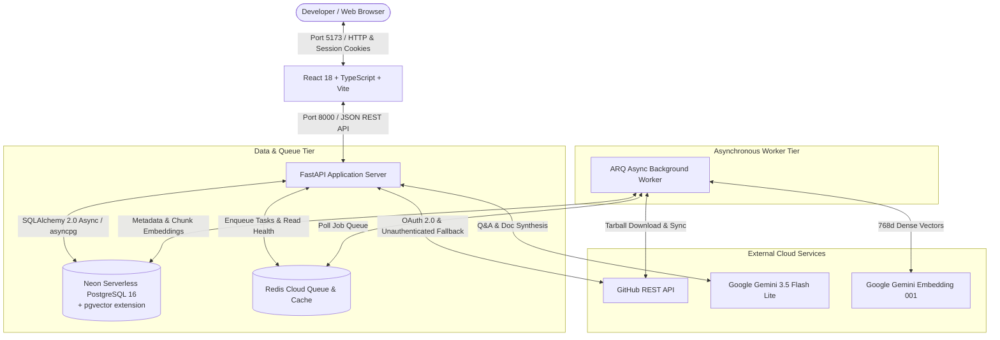

# Repo Cartographer — System Architecture Documentation (v1.0)

## 1. System Overview

**Repo Cartographer** is an AI developer productivity platform that bridges repository metadata, git histories, issue/PR threads, and source code semantics into a unified hybrid retrieval and generative intelligence system.

Built for production execution against real cloud services—including **Neon Serverless PostgreSQL** with `pgvector`, **Redis Cloud**, **Google Gemini**, and the **GitHub REST API**—the platform delivers end-to-end codebase exploration, hybrid code search, conversational Q&A with verified citations, architecture documentation generation, and automated unit test generation.

---

## 2. Component Architecture

---

## 3. Core Pipelines & Workflows

### 3.1 GitHub OAuth 2.0 & Security Architecture
1. **CSRF State Signing**: Random state parameter signed with HMAC-SHA256 (`SECRET_KEY`) stored in an `httpOnly`, `SameSite=Lax` cookie (`rc_oauth_state`).
2. **State Validation**: Verified upon GitHub redirect to prevent Cross-Site Request Forgery.
3. **Token Encryption at Rest**: GitHub OAuth tokens are encrypted using AES-128 Fernet encryption (`FERNET_KEY`) before saving to PostgreSQL.
4. **Stateless Sessions**: Session JWT signed with `SECRET_KEY` stored in an `httpOnly`, `SameSite=Lax` cookie (`rc_session`).
5. **Unauthenticated Public Fallback**: When tokens expire or are revoked, read requests on public repositories gracefully fall back to unauthenticated GitHub access (60 req/hr) without failing.

### 3.2 Asynchronous Ingestion Pipeline
When a repository is imported (`POST /repos/import`) or re-synchronized (`POST /repos/{id}/sync`), the API updates the repository status and pushes a lightweight job to Redis:
1. **Stage 1 (Metadata)**: Fetches repository descriptions, default branches, primary language, and commit head.
2. **Stage 2 (Commits)**: Paginated commit fetching with rate-limit tracking and stat collection for recent items.
3. **Stage 3 (Pull Requests)**: Ingests PR records, merge states, diff statistics, and labels.
4. **Stage 4 (Issues)**: Ingests GitHub issue threads (excluding pull requests).
All stages use PostgreSQL idempotent upserts (`INSERT ... ON CONFLICT DO UPDATE`).

### 3.3 Codebase Chunking & Embedding Pipeline
1. **In-Memory Tarball Extraction**: Downloads legacy tarball archives for the default branch without writing to local disk, bounded by `INDEX_MAX_REPO_DOWNLOAD_MB` (100MB) and `INDEX_MAX_FILES` (1,500).
2. **AST-Aware Code Chunking**: Prioritizes source files, splitting code into logical chunk boundaries (functions, classes, top-level blocks) capped at 1,500 chunks.
3. **Immediate Batch Persistence**: Batches of 16 chunks are embedded via Gemini (`gemini-embedding-001`) and committed to the database immediately, allowing interrupted indexing to resume seamlessly.
4. **Dynamic Pacing & Rate Limit Backoff**: Client-side `GeminiRequestPacer` enforces requests-per-minute limits; HTTP 429/503 errors parse `Retry-After` headers and Google RPC `RetryInfo` to back off with jitter up to `EMBED_MAX_WAIT_SECONDS` (600s).

### 3.4 Hybrid Code Search (BM25 + pgvector RRF)
1. **Keyword Channel**: Full-text search using PostgreSQL `tsvector` with `plainto_tsquery` ranking.
2. **Semantic Channel**: Dense cosine distance vector search (`<=>`) against `code_chunks.embedding` using pgvector.
3. **Reciprocal Rank Fusion**: RRF merges ranked results from both channels ($k=60$) to balance exact keyword precision with semantic conceptual recall.
4. **Permalink Generation**: Every result contains a validated GitHub blob permalink to the exact line range (`https://github.com/owner/repo/blob/<sha>/path#L<start>-L<end>`).

### 3.5 Grounded Codebase Q&A (Ask) with Citation Verification
1. **Context Assembly**: Retrieves top-k relevant chunks across the repository based on semantic query similarity.
2. **Prompt Injection**: Injects numbered source blocks (`[S1]`, `[S2]`) with untrusted data boundaries.
3. **Citation Validation**: Synthesizes responses with Gemini 3.5 Flash Lite; post-processing regex strictly validates that every cited marker matches a retrieved snippet, stripping any ungrounded citations.

### 3.6 Architecture Documentation Generation
1. Synthesizes an architectural blueprint from manifests (`package.json`, `pyproject.toml`, etc.), top-level file trees, and semantic queries for core entry points and schemas.
2. Formats structured markdown sections: Purpose, Tech Stack, Setup, Project Structure, and Component Workflows with validated citation badges.

---

## 4. Database Schema

### `users`
- `id` (UUID, Primary Key)
- `github_id` (BIGINT, Unique, Indexed)
- `login` (VARCHAR, Indexed)
- `name`, `avatar_url`, `email` (VARCHAR/TEXT)
- `encrypted_access_token` (TEXT)
- `created_at`, `updated_at` (TIMESTAMPTZ)

### `repositories`
- `id` (UUID, Primary Key)
- `user_id` (UUID, FK -> `users.id` ON DELETE CASCADE)
- `github_id` (BIGINT, Indexed)
- `full_name` (VARCHAR, Indexed)
- `description`, `default_branch`, `language` (VARCHAR/TEXT)
- `is_private` (BOOLEAN)
- `status` (VARCHAR: `pending` | `syncing` | `ready` | `failed`)
- `index_status` (VARCHAR: `not_started` | `indexing` | `ready` | `failed`)
- `indexed_commit_sha` (VARCHAR(40))
- `chunk_count` (INTEGER)
- `last_synced_at`, `indexed_at` (TIMESTAMPTZ)
- `sync_error`, `index_error` (TEXT)

### `code_chunks`
- `id` (UUID, Primary Key)
- `repo_id` (UUID, FK -> `repositories.id` ON DELETE CASCADE)
- `file_id` (UUID, FK -> `repo_files.id` ON DELETE CASCADE)
- `path` (VARCHAR, Indexed)
- `chunk_index` (INTEGER)
- `start_line`, `end_line` (INTEGER)
- `language`, `kind`, `symbol` (VARCHAR)
- `content` (TEXT)
- `content_hash` (VARCHAR(64), Indexed)
- `embedding` (VECTOR(768), pgvector)
- `tsv` (TSVECTOR, Indexed for full-text search)

### `repo_docs`
- `id` (UUID, Primary Key)
- `repo_id` (UUID, FK -> `repositories.id` ON DELETE CASCADE)
- `doc_type` (VARCHAR: `architecture` | `readme`)
- `status` (VARCHAR: `not_started` | `pending` | `generating` | `ready` | `failed`)
- `content_markdown` (TEXT)
- `citations` (JSONB)
- `model`, `indexed_commit_sha`, `error` (VARCHAR/TEXT)

### `sync_jobs` & `index_jobs`
- `id` (UUID, Primary Key)
- `repo_id` (UUID, FK -> `repositories.id` ON DELETE CASCADE)
- `status` (VARCHAR: `pending` | `running` | `completed` | `failed`)
- `stage` (VARCHAR), `progress` (INTEGER)
- `error` (TEXT), `started_at`, `finished_at` (TIMESTAMPTZ)

---

## 5. Reliability & Stuck-Job Recovery

1. **Atomic Status Updates**: Job records and repository statuses are updated together within single database transactions.
2. **Reconciliation & Expiry**: On status reads, if a repository is flagged as `syncing` or `indexing` but no active non-expired job exists, the system automatically resets the status to its terminal state.
3. **409 Conflict Guards**: Sync and Index routes check for active non-expired jobs in the queue rather than stale repository flags, allowing instant Retries or Re-syncs after expired or completed runs.
4. **Worker Startup Cleanups**: When the ARQ worker boots, it queries the database for interrupted jobs marked `running` and flags them as failed (`"Interrupted by a worker restart"`), immediately reconciling repository statuses.
