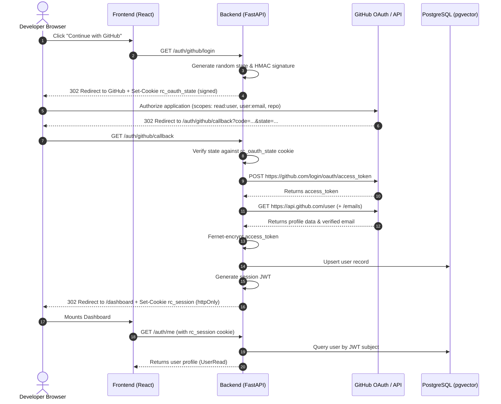

# Repo-Cartographer Architecture Documentation

## 1. System Overview

**repo-cartographer** is an AI developer productivity platform designed to bridge repository metadata, git histories, issue/PR threads, and source code semantics into a unified graph and vector retrieval system (RAG with source citations).

This document outlines the architecture established in **Phase 1: Foundation + GitHub OAuth**, and provides the architectural blueprint for Phases 2 through 6.

---

## 2. High-Level Component Architecture

```mermaid
graph TD
    User([Developer / Browser]) <-->|HTTP / Session Cookie| Frontend[React + Vite Frontend<br/>:5173]
    Frontend <-->|REST API / Reverse Proxy| Backend[FastAPI Application<br/>:8000]
    
    subgraph Core Infrastructure
        Backend <-->|SQLAlchemy 2.0 Async| DB[(PostgreSQL 16<br/>+ pgvector)]
        Backend <-->|Enqueue Sync Jobs| Redis[(Redis 7 Cache / Queue)]
        Backend <-->|HTTPX / OAuth| GitHub[GitHub API / OAuth]
    end

    subgraph Async Ingestion (Phase 2)
        Worker[ARQ Background Worker] <-->|Poll Job Queue| Redis
        Worker <-->|Token Decryption & Rate Limiting| GitHub
        Worker <-->|Idempotent Upserts| DB
    end

    subgraph Future Expansion (Phases 3-6)
        Worker -.-> AST[AST Parsing & Code Graph]
        AST -.-> Embeddings[pgvector Embeddings & RAG]
        Embeddings -.-> DB
    end
```

---

## 3. GitHub OAuth 2.0 Web Application Flow

The authentication system employs defense-in-depth security principles:
1. **CSRF State Signing**: A cryptographically random state parameter is generated, signed with HMAC-SHA256 using the server's `SECRET_KEY`, and set in an `httpOnly`, `SameSite=Lax` cookie.
2. **State Validation**: On callback, the returned state parameter is verified against the signed cookie to thwart Cross-Site Request Forgery.
3. **Token Encryption at Rest**: The raw GitHub access token returned by GitHub is encrypted with `Fernet` (AES-128-CBC with HMAC-SHA256) before persistence in PostgreSQL.
4. **Stateless Session Management**: A session JWT containing the user's UUID and GitHub handle is issued in an `httpOnly`, `SameSite=Lax` cookie (`rc_session`), shielding it from XSS token theft.



---

## 4. Phase 2: Ingestion Pipeline & ARQ Worker Architecture

When a repository is imported (`POST /repos/import`) or re-synchronized (`POST /repos/{id}/sync`), the API updates the repository status to `pending`, persists a `SyncJob`, and pushes a lightweight job payload containing the `repo_id` to the Redis queue (`repo_cartographer:queue`).

The standalone ARQ worker dequeues the job and executes the 4-stage ingestion pipeline:

```mermaid
sequenceDiagram
    autonumber
    actor Client as Frontend / User
    participant API as FastAPI Backend
    participant Redis as Redis Job Queue
    participant Worker as ARQ Worker
    participant ClientGH as GitHubClient
    participant DB as PostgreSQL

    Client->>API: POST /repos/import { full_name }
    API->>ClientGH: GET /repos/:owner/:repo
    ClientGH-->>API: Metadata
    API->>DB: INSERT INTO repositories (status='pending')
    API->>DB: INSERT INTO sync_jobs (status='pending', stage='queued', progress=0)
    API->>Redis: enqueue_job('execute_repo_sync_job', repo_id)
    API-->>Client: 201 Created (Repository + SyncJob)

    Note over Worker,Redis: Background Job Execution
    Worker->>Redis: Dequeue execute_repo_sync_job
    Worker->>DB: Update SyncJob (status='running', stage='metadata', progress=10)

    rect rgb(20, 24, 39)
        Note over Worker,DB: Stage 1: Metadata (progress 10-25%)
        Worker->>ClientGH: get_repo(owner, repo)
        Worker->>DB: UPDATE repositories SET description, default_branch, language
    end

    rect rgb(20, 24, 39)
        Note over Worker,DB: Stage 2: Commits (progress 30-50%)
        Worker->>ClientGH: list_commits(owner, repo, max_items)
        Worker->>ClientGH: get_commit(sha) stats for recent N commits
        Worker->>DB: INSERT INTO commits ON CONFLICT (repo_id, sha) DO UPDATE
    end

    rect rgb(20, 24, 39)
        Note over Worker,DB: Stage 3: Pull Requests (progress 55-75%)
        Worker->>ClientGH: list_pull_requests(owner, repo, state='all')
        Worker->>ClientGH: get_pull_request(number) stats for recent N PRs
        Worker->>DB: INSERT INTO pull_requests ON CONFLICT (repo_id, number) DO UPDATE
    end

    rect rgb(20, 24, 39)
        Note over Worker,DB: Stage 4: Issues (progress 80-95%)
        Worker->>ClientGH: list_issues(owner, repo, state='all')
        Note over Worker: Filter out items with 'pull_request' key
        Worker->>DB: INSERT INTO issues ON CONFLICT (repo_id, number) DO UPDATE
    end

    Worker->>DB: UPDATE repositories SET status='ready', last_synced_at=now()
    Worker->>DB: UPDATE sync_jobs SET status='completed', progress=100
```



### GitHub API Resilience & Rate Limit Strategy
- **RFC 5988 Pagination**: Parses `<url>; rel="next"` link headers to traverse paginated endpoints until `max_items` or last page.
- **Rate Limit Tracking**: Monitors `x-ratelimit-remaining` and `x-ratelimit-reset`. If exhausted, raises `GitHubRateLimitExhaustedError` with wait duration.
- **Secondary Rate Limit Protection**: Detects GitHub 403/429 secondary rate limit responses, honors the `Retry-After` header, and retries with backoff.
- **Exponential Backoff**: Automatic retries with exponential backoff on transient HTTP 5xx errors.
- **Stat Throttling**: Line-change stats (`additions`, `deletions`, `files_changed`) require individual per-item API requests. To protect rate limits, stats are fetched only for the most recent `SYNC_STATS_COMMITS_LIMIT` (default 25) and `SYNC_STATS_PRS_LIMIT` (default 25) items.

### Idempotent Database Upserts
All ingestion stages employ PostgreSQL `INSERT ... ON CONFLICT (...) DO UPDATE` statements:
- Commits: `ON CONFLICT (repo_id, sha) DO UPDATE`
- Pull Requests: `ON CONFLICT (repo_id, number) DO UPDATE`
- Issues: `ON CONFLICT (repo_id, number) DO UPDATE`

Re-syncing a repository refreshes existing records without creating duplicates.

---

## 5. Database Schema

### `users` Table
| Column Name | Type | Constraints / Defaults | Description |
| :--- | :--- | :--- | :--- |
| `id` | `UUID` | Primary Key, `gen_random_uuid()` | Internal user ID |
| `github_id` | `BIGINT` | Unique, Not Null, Indexed | GitHub user ID |
| `login` | `VARCHAR(255)` | Not Null, Indexed | GitHub handle |
| `name` | `VARCHAR(255)` | Nullable | Display name |
| `avatar_url` | `TEXT` | Nullable | Avatar URL |
| `email` | `VARCHAR(255)` | Nullable, Indexed | Verified primary email |
| `encrypted_access_token`| `TEXT` | Not Null | Fernet-encrypted access token |
| `created_at` | `TIMESTAMPTZ` | Not Null, `now()` | Timestamp created |
| `updated_at` | `TIMESTAMPTZ` | Not Null, `now()` | Timestamp updated |

### `repositories` Table
| Column Name | Type | Constraints / Defaults | Description |
| :--- | :--- | :--- | :--- |
| `id` | `UUID` | Primary Key | Repository ID |
| `user_id` | `UUID` | FK -> `users.id` ON DELETE CASCADE | Owner user |
| `github_id` | `BIGINT` | Not Null, Indexed | GitHub repository ID |
| `full_name` | `VARCHAR(255)` | Not Null, Indexed | `owner/repo` format |
| `description` | `TEXT` | Nullable | Repository description |
| `default_branch`| `VARCHAR(100)`| Default `'main'` | Default git branch |
| `language` | `VARCHAR(100)` | Nullable | Primary language |
| `is_private` | `BOOLEAN` | Default `false` | Visibility flag |
| `status` | `VARCHAR(50)` | Default `'pending'`, Indexed | `pending`\|`syncing`\|`ready`\|`failed` |
| `last_synced_at`| `TIMESTAMPTZ` | Nullable | Last successful sync |
| `sync_error` | `TEXT` | Nullable | Error message if failed |
| `created_at` / `updated_at` | `TIMESTAMPTZ` | Not Null, `now()` | Timestamps |

*Unique Constraint*: `(user_id, github_id)`

### `commits` Table
| Column Name | Type | Constraints / Defaults | Description |
| :--- | :--- | :--- | :--- |
| `id` | `UUID` | Primary Key | Commit record ID |
| `repo_id` | `UUID` | FK -> `repositories.id` ON DELETE CASCADE | Parent repo |
| `sha` | `VARCHAR(40)` | Not Null, Indexed | Git commit SHA |
| `author_login` | `VARCHAR(255)` | Nullable, Indexed | GitHub author handle |
| `author_name` | `VARCHAR(255)` | Nullable | Git author name |
| `message` | `TEXT` | Not Null | Commit message |
| `committed_at` | `TIMESTAMPTZ` | Not Null, Indexed | Commit timestamp |
| `additions` | `INTEGER` | Nullable | Lines added |
| `deletions` | `INTEGER` | Nullable | Lines removed |
| `files_changed`| `INTEGER` | Nullable | Number of changed files |

*Unique Constraint*: `(repo_id, sha)`

### `pull_requests` Table
| Column Name | Type | Constraints / Defaults | Description |
| :--- | :--- | :--- | :--- |
| `id` | `UUID` | Primary Key | Pull request ID |
| `repo_id` | `UUID` | FK -> `repositories.id` ON DELETE CASCADE | Parent repo |
| `number` | `INTEGER` | Not Null, Indexed | PR number (`#123`) |
| `title` | `VARCHAR(500)` | Not Null | PR title |
| `body` | `TEXT` | Nullable | PR description markdown |
| `state` | `VARCHAR(50)` | Not Null, Indexed | `open`\|`closed` |
| `author_login` | `VARCHAR(255)` | Nullable, Indexed | Author handle |
| `created_at` | `TIMESTAMPTZ` | Not Null, Indexed | Creation timestamp |
| `merged_at` | `TIMESTAMPTZ` | Nullable | Merge timestamp |
| `closed_at` | `TIMESTAMPTZ` | Nullable | Close timestamp |
| `additions` / `deletions` / `changed_files` | `INTEGER` | Nullable | Diff stats |
| `base_ref` / `head_ref` | `VARCHAR(255)` | Nullable | Target / source branches |

*Unique Constraint*: `(repo_id, number)`

### `issues` Table
| Column Name | Type | Constraints / Defaults | Description |
| :--- | :--- | :--- | :--- |
| `id` | `UUID` | Primary Key | Issue ID |
| `repo_id` | `UUID` | FK -> `repositories.id` ON DELETE CASCADE | Parent repo |
| `number` | `INTEGER` | Not Null, Indexed | Issue number (`#45`) |
| `title` | `VARCHAR(500)` | Not Null | Issue title |
| `body` | `TEXT` | Nullable | Issue body markdown |
| `state` | `VARCHAR(50)` | Not Null, Indexed | `open`\|`closed` |
| `labels` | `JSONB` | Default `[]` | Issue labels with colors |
| `author_login` | `VARCHAR(255)` | Nullable, Indexed | Author handle |
| `created_at` | `TIMESTAMPTZ` | Not Null, Indexed | Creation timestamp |
| `closed_at` | `TIMESTAMPTZ` | Nullable | Close timestamp |

*Unique Constraint*: `(repo_id, number)`

### `sync_jobs` Table
| Column Name | Type | Constraints / Defaults | Description |
| :--- | :--- | :--- | :--- |
| `id` | `UUID` | Primary Key | Sync job ID |
| `repo_id` | `UUID` | FK -> `repositories.id` ON DELETE CASCADE | Target repository |
| `status` | `VARCHAR(50)` | Default `'pending'`, Indexed | `pending`\|`running`\|`completed`\|`failed` |
| `stage` | `VARCHAR(50)` | Default `'queued'` | `queued`\|`metadata`\|`commits`\|`pull_requests`\|`issues`\|`completed`\|`failed` |
| `progress` | `INTEGER` | Default `0` | Percentage `0` to `100` |
| `error` | `TEXT` | Nullable | Error message if failed |
| `started_at` / `finished_at` | `TIMESTAMPTZ` | Nullable | Timing data |
| `created_at` | `TIMESTAMPTZ` | Not Null, `now()` | Job queue timestamp |

---

## 6. Phased Roadmap

```
[Phase 1: Foundation & OAuth] (Complete)
   ├── PostgreSQL 16 + pgvector initialized
   ├── GitHub OAuth web application flow + Fernet encryption
   └── Docker Compose + React frontend + Health monitoring
          │
          ▼
[Phase 2: Repository Ingestion & ARQ Worker] (Complete)
   ├── Redis-backed ARQ worker pool for background ingestion
   ├── 4-stage sync pipeline (Metadata, Commits, PRs, Issues)
   ├── Rate limit handling, exponential backoff, and pagination
   └── Tabbed React repository inspection UI with live polling
          │
          ▼
[Phase 3: AST Parsing & Code Cartography]
   ├── Tree-sitter multi-language code parsing
   └── File & symbol dependency graph construction
          │
          ▼
[Phase 4: Vector Embeddings & Hybrid Search]
   ├── Text & code chunking pipeline
   └── pgvector indexing (HNSW / IVFFlat)
          │
          ▼
[Phase 5: RAG Engine with Citations]
   ├── Context retriever (Graph + Vector hybrid)
   └── LLM inference engine with file & line citations
          │
          ▼
[Phase 6: Visual Cartographer Frontend]
   ├── Interactive 3D/2D codebase graph visualization
   └── Citations-backed AI developer copilot chat
```

