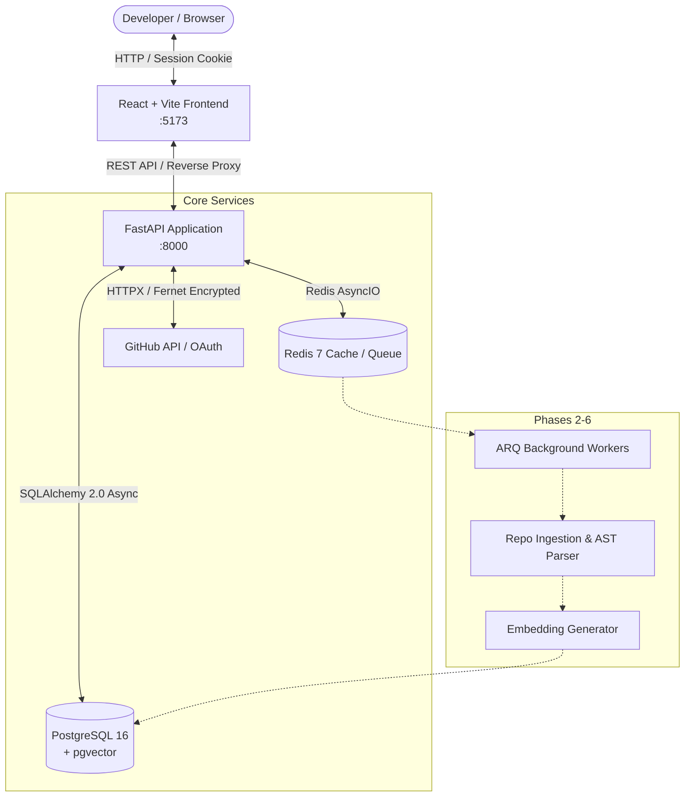
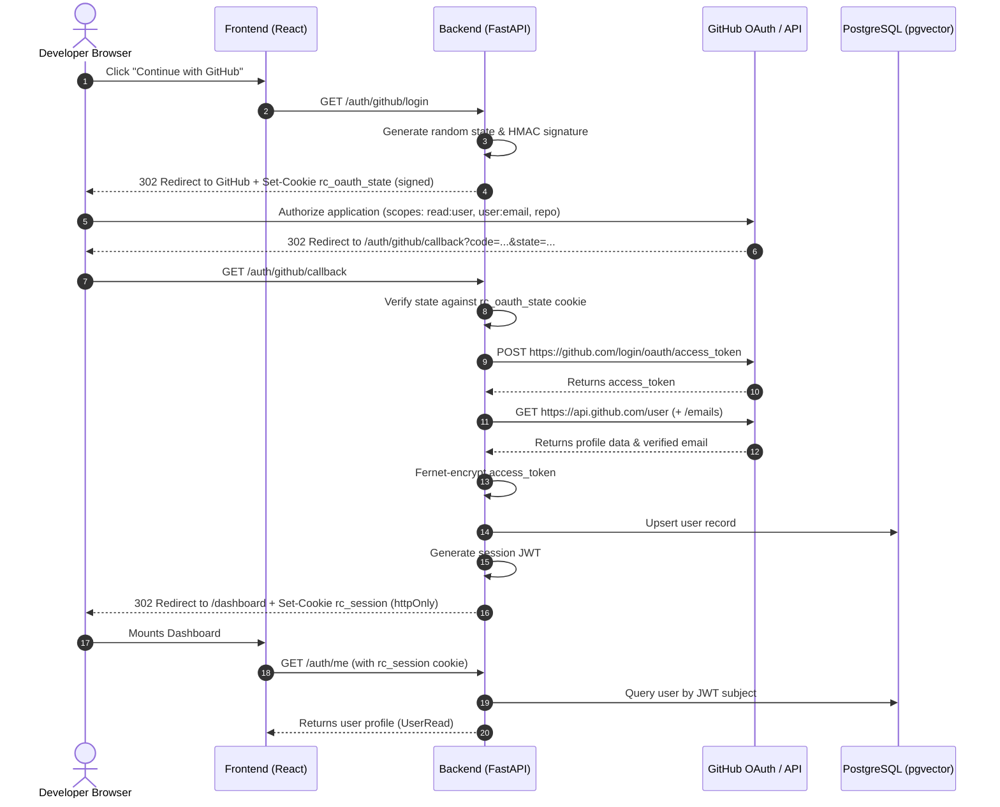

# Repo-Cartographer Architecture Documentation

## 1. System Overview

**repo-cartographer** is an AI developer productivity platform designed to bridge repository metadata, git histories, issue/PR threads, and source code semantics into a unified graph and vector retrieval system (RAG with source citations).

This document outlines the architecture established in **Phase 1: Foundation + GitHub OAuth**, and provides the architectural blueprint for Phases 2 through 6.

---

## 2. High-Level Component Architecture



---

## 3. GitHub OAuth 2.0 Web Application Flow

The authentication system employs defense-in-depth security principles:
1. **CSRF State Signing**: A cryptographically random state parameter is generated, signed with HMAC-SHA256 using the server's `SECRET_KEY`, and set in an `httpOnly`, `SameSite=Lax` cookie.
2. **State Validation**: On callback, the returned state parameter is verified against the signed cookie to thwart Cross-Site Request Forgery.
3. **Token Encryption at Rest**: The raw GitHub access token returned by GitHub is encrypted with `Fernet` (AES-128-CBC with HMAC-SHA256) before persistence in PostgreSQL.
4. **Stateless Session Management**: A session JWT containing the user's UUID and GitHub handle is issued in an `httpOnly`, `SameSite=Lax` cookie (`rc_session`), shielding it from XSS token theft.



---

## 4. Database Schema (Phase 1)

### `pgvector` Extension
The database initializes the `vector` extension in PostgreSQL 16:
```sql
CREATE EXTENSION IF NOT EXISTS vector;
```

### `users` Table
| Column Name | Type | Constraints / Defaults | Description |
| :--- | :--- | :--- | :--- |
| `id` | `UUID` | Primary Key, `gen_random_uuid()` | Internal unique identifier |
| `github_id` | `BIGINT` | Unique, Not Null, Indexed | GitHub user ID |
| `login` | `VARCHAR(255)` | Not Null, Indexed | GitHub username / handle |
| `name` | `VARCHAR(255)` | Nullable | GitHub display name |
| `avatar_url` | `TEXT` | Nullable | URL to user's profile picture |
| `email` | `VARCHAR(255)` | Nullable, Indexed | Verified primary email |
| `encrypted_access_token`| `TEXT` | Not Null | Fernet-encrypted GitHub OAuth token |
| `created_at` | `TIMESTAMPTZ` | Not Null, `now()` | Account creation timestamp |
| `updated_at` | `TIMESTAMPTZ` | Not Null, `now()` | Account last update timestamp |

---

## 5. Security Architecture

- **Fernet Token Encryption**: GitHub access tokens grant `repo` permissions to clone and inspect private/public user code. Storing these tokens in plaintext is a catastrophic security vulnerability. Fernet guarantees that tokens stored at rest in PostgreSQL cannot be decrypted without the secret `FERNET_KEY`.
- **Signed CSRF State**: Prevents OAuth state injection and login CSRF vulnerabilities.
- **httpOnly, SameSite=Lax Cookies**: Tokens are never accessible via JavaScript `document.cookie`, mitigating client-side XSS exploitation.
- **Strict Typing & Pydantic Validation**: All environment variables and request/response payloads are validated at runtime via Pydantic v2.

---

## 6. Phased Roadmap & Future Extension Points

```
[Phase 1: Foundation & OAuth] (Current)
   ├── PostgreSQL 16 + pgvector initialized
   ├── GitHub OAuth web application flow + Fernet encryption
   └── Docker Compose + React frontend + Health monitoring
          │
          ▼
[Phase 2: Repository Ingestion & ARQ Worker]
   ├── GitHub webhook listener & background queue (Redis + ARQ)
   └── Repository cloning, commit history parsing, PR/issue extraction
          │
          ▼
[Phase 3: AST Parsing & Code Cartography]
   ├── Tree-sitter multi-language code parsing
   └── File & symbol dependency graph construction
          │
          ▼
[Phase 4: Vector Embeddings & Hybrid Search]
   ├── Text & code chunking pipeline
   └── pgvector indexing (HNSW / IVFFlat)
          │
          ▼
[Phase 5: RAG Engine with Citations]
   ├── Context retriever (Graph + Vector hybrid)
   └── LLM inference engine with file & line citations
          │
          ▼
[Phase 6: Visual Cartographer Frontend]
   ├── Interactive interactive 3D/2D codebase graph visualization
   └── Citations-backed AI developer copilot chat
```
